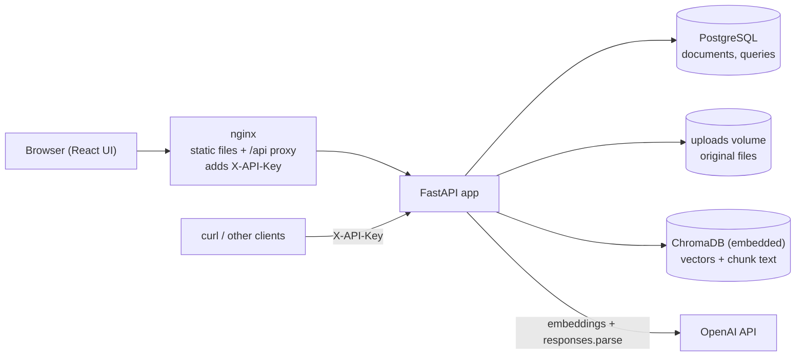

# DocuAsk

Upload PDF/DOCX documents, ask questions in natural language, get an answer **grounded only in those documents**, with **verifiable citations** (file, page, exact quote) - or an honest refusal when the documents contain no answer.

> **This is a personal portfolio project**, not a product and not a benchmark. It is the productized version of a learning project (a minimal RAG) and the base for a "RAG chatbot for your documents" service. Quality is *measured* on a small internal evaluation set (see [Evaluation](#evaluation)); no number in this README is invented, and where a number does not exist yet, the README says so.

## What it does

1. **Upload** (`POST /documents`) - validates the file by content (PDF magic bytes / DOCX zip structure, not just the extension), size and page limits; parses it; chunks it; embeds the chunks with OpenAI; stores vectors + text in ChromaDB and metadata in PostgreSQL. The same file uploaded twice is recognised by its SHA-256 and does **not** call the embeddings API again.
2. **Ask** (`POST /ask`) - embeds the question, retrieves the top-k chunks, and if the best chunk is not similar enough **refuses without calling the LLM**. Otherwise the LLM answers strictly from the retrieved chunks and must cite them. Plain Python then verifies every citation (the chunk was really retrieved, the quote really occurs in it). One retry on failure, then an honest refusal - **unverified citations are never returned**.
3. **Preview / manage** - list, fetch, download the original (for a source viewer), delete (database row + stored file + vectors).

## Architecture



The ask pipeline, step by step:

```
question
  -> embed (text-embedding-3-small)
  -> Chroma top_k (cosine), optional document_ids filter
  -> best score < SCORE_THRESHOLD ?  --yes-->  refuse (reason=below_score_threshold), NO LLM CALL
  -> build prompt: system rules + <context><chunk id="C1" ...>...</chunk></context> + <question>
  -> LLM (structured output: answerable, citations[{chunk_id, quote}], answer)
  -> answerable=false ?  --yes-->  refuse (reason=no_answer_in_documents)
  -> validate citations in plain Python (chunk id retrieved? quote inside that chunk?)
        fail -> retry once with the reasons -> fail again -> refuse (reason=citation_validation_failed)
  -> response: answer + citations (filled from OUR metadata: file, page) + retrieved chunks + usage
  -> log metrics row in PostgreSQL (question text and token counts only; no document text)
```

Code layout (deliberately Spring-like, no extra abstractions):

```
app/
  api/           routes + dependency wiring (deps.py is the "configuration class")
  services/      file_validation, parsing, chunking, embeddings, vector_store, retrieval,
                 answering (prompt + LLM + orchestration), citation_validation, documents, ingestion
  repositories/  documents, queries (SQLAlchemy)
  schemas/       Pydantic request/response models (ask.py, documents.py, llm.py, health.py)
  models/        SQLAlchemy entities (Document, Query)
  core/          config, logging (JSON + request id), security (API key), errors, database, openai client
frontend/        React + Vite UI, nginx config and Dockerfile (served by the `web` compose service)
alembic/         migrations (no create_all in application code)
eval/            evaluation set, metrics, runner, reports
scripts/         ingest_query.py (see real scores), capture_examples.py (real API examples)
tests/           unit + API tests, synthetic sample documents in tests/samples
```

## Quick start

Requirements: Docker (with Compose). For local development: Python 3.9+.

```bash
cp .env.example .env
# edit .env: set API_KEY (python -c "import secrets; print(secrets.token_urlsafe(32))") and OPENAI_API_KEY
docker compose up --build
```

`docker compose up` starts PostgreSQL, the API (it runs `alembic upgrade head` before serving) and the web UI. Open **`http://localhost:8080`** for the UI (`WEB_HOST_PORT`) or `http://localhost:8000/docs` for Swagger (`API_HOST_PORT`). Uploaded files and the Chroma index live in the named volumes `uploads` and `chroma`, the database in `pgdata`; they survive `docker compose down` (use `down -v` to wipe).

Local development without the API container:

```bash
python -m venv .venv && .venv/bin/pip install -r requirements-dev.txt     # Windows: .venv\Scripts\...
docker compose up -d postgres
.venv/bin/python -m alembic upgrade head
.venv/bin/python -m uvicorn app.main:app --reload
.venv/bin/python -m pytest -q
```

### Web UI

React + Vite + TypeScript, served by nginx (`frontend/`). Upload by drag and drop, pick which documents to search, ask, and see the answer with its citations. **View in source** opens a drawer with the retrieved passage and the verified quote highlighted, plus the original PDF at the cited page (DOCX has no pages and no browser renderer, so it offers a download). A collapsible **debug panel** shows every retrieved chunk with its cosine score, which ones were cited, latency, token usage and whether the citation retry happened. Refusals are shown as refusals, with the reason in plain words.

nginx proxies `/api/*` to the API and **adds the `X-API-Key` header itself**, so the key is never in the JavaScript bundle. The consequence: whoever can open the web port can use the whole API. The port is therefore bound to `127.0.0.1` by default (`WEB_BIND`); put real authentication in front before exposing it.

Frontend development with hot reload (API running on `API_HOST_PORT`; the dev server proxies `/api` and adds the key from `.env`):

```bash
cd frontend && npm ci && npm run dev      # http://localhost:5173
npm test && npm run typecheck
```

### Look at real retrieval scores (needs `OPENAI_API_KEY`)

```bash
python -m scripts.ingest_query tests/samples/employee_handbook.pdf \
    -q "How many vacation days do I get?" -q "What is the dress code?"
```

It prints the cosine score of every retrieved chunk and whether the question would pass the threshold - the raw material for choosing `SCORE_THRESHOLD`.

## API

All endpoints except `/health` require the header `X-API-Key`. Errors share one shape: `{"error": {"code", "message"}, "request_id"}`; stack traces never reach the client (they go to the log, correlated by `request_id`).

| Method | Path | Purpose |
|---|---|---|
| POST | `/documents` | multipart upload (`file`) -> document record. `201` new, `200` + `already_processed: true` for a duplicate |
| GET | `/documents` | list |
| GET | `/documents/{id}` | one document |
| GET | `/documents/{id}/file` | the original file, inline, correct content type (for preview) |
| DELETE | `/documents/{id}` | row + stored file + vectors |
| POST | `/ask` | `{question, document_ids?, top_k?}` -> `AskResponse` |
| GET | `/health` | PostgreSQL + vector store reachability (never calls OpenAI) |

Status codes: `401` bad key, `404` unknown document, `413` file too large, `422` unsupported / unreadable / scanned (no text layer) / too many pages / invalid request, `502` OpenAI failed after retries, `503` server not configured (no `OPENAI_API_KEY`, or a Chroma collection that is not cosine / was built with another embedding model).

`AskResponse`:

```jsonc
{
  "answer": "...",
  "answerable": true,
  "reason": null,                // else: below_score_threshold | no_answer_in_documents |
                                 //       citation_validation_failed | llm_refused | no_documents
  "citations": [{ "document_id": "...", "filename": "...", "page": 2,      // page is null for DOCX
                  "section": null, "para_index": null,                      // DOCX: heading path, paragraph no.
                  "chunk_id": "<doc-uuid>:<n>", "quote": "..." }],
  "retrieved": [{ "chunk_id": "...", "score": 0.61, "document_id": "...", "filename": "...", "page": 2, "section": null, "text": "..." }],
  "usage": { "prompt_tokens": 0, "completion_tokens": 0, "latency_ms": 0, "embedding_tokens": 0, "llm_calls": 0, "model": null }
}
```

`citations` fields (`document_id`, `filename`, `page`) are copied from **our** chunk metadata, never produced by the model, so the model cannot invent a page number.

### Example requests

```bash
KEY=...   # your API_KEY
curl -s -H "X-API-Key: $KEY" -F "file=@tests/samples/employee_handbook.pdf" http://localhost:8000/documents
curl -s -H "X-API-Key: $KEY" -H "Content-Type: application/json" \
     -d '{"question": "How many days of paid annual leave do employees get?"}' http://localhost:8000/ask
```

### Example responses

**Captured from the Docker deployment, independent of the model** (real server output; ids and timestamps are from that run):

```jsonc
// GET /health -> 200
{"status": "ok", "database": "ok", "vector_store": "ok"}

// GET /documents without a key -> 401
{"error": {"code": "unauthorized", "message": "Missing or invalid API key."}, "request_id": "c5c197f505c843728a84c7c4c63ee9c4"}

// POST /documents notes.txt -> 422
{"error": {"code": "unsupported_file_type", "message": "Only .pdf and .docx files are supported."}, "request_id": "8641216aeb9145078de5e524cde64398"}

// POST /documents with a PDF that has no text layer (a scan) -> 422
{"error": {"code": "no_extractable_text", "message": "No extractable text found. Scanned documents are not supported (OCR is out of scope)."}, "request_id": "fc68ab136de7474bb56893c046004c5b"}

// POST /documents with a 21 MB file (limit 20 MB) -> 413
{"error": {"code": "file_too_large", "message": "File is larger than the limit of 20 MB."}, "request_id": "d4000e27b94b41848ed0a1e6f97f950c"}

// POST /documents employee_handbook.pdf -> 201
{"id": "debece66-35eb-42d1-8fa1-767a3dba77a0", "filename": "employee_handbook.pdf", "file_type": "pdf", "page_count": 6,
 "chunk_count": 12, "status": "ready", "created_at": "2026-10-10T14:17:34.244589Z", "already_processed": false}

// the same bytes again (any filename) -> 200, same id, embeddings API not called
{"id": "debece66-35eb-42d1-8fa1-767a3dba77a0", "filename": "employee_handbook.pdf", "file_type": "pdf", "page_count": 6,
 "chunk_count": 12, "status": "ready", "created_at": "2026-10-10T14:17:34.244589Z", "already_processed": true}
```

**`/ask` responses - READ THIS:** the three examples below were captured from the real server running in Docker, but with a **local stub in place of the OpenAI API** (`OPENAI_BASE_URL`), used once to verify the deployment end to end (migrations, volumes, restart persistence, delete cascade). Everything the *application* produces is real - refusal text, `reason`, citation fields copied from chunk metadata, scores, token bookkeeping, the retry - but the stub's "model output" and its token counts (1234 / 56) are **not** model output and the stub's embeddings are a toy bag-of-words vector, so the scores say nothing about OpenAI embeddings. Genuine examples are produced by `python -m scripts.capture_examples --api-key ...` against a deployment with a real key (they land in `docs/examples/`).

```jsonc
// POST /ask {"question": "zebra quantum saxophone"} -> refusal BEFORE the LLM (llm_calls = 0, no model, zero tokens)
{"answer": "The uploaded documents do not contain an answer to this question.", "answerable": false,
 "reason": "below_score_threshold", "citations": [],
 "retrieved": [{"chunk_id": "36b9...:2", "score": 0.0, "filename": "employee_handbook.pdf", "page": 2, "section": null, "text": "Northwind Labs Employee Handbook - Page 2 2. Leave and Time ..."}, "..."],
 "usage": {"prompt_tokens": 0, "completion_tokens": 0, "latency_ms": 33, "embedding_tokens": 3, "llm_calls": 0, "model": null}}

// POST /ask {"question": "How many days of paid annual leave?"} -> answered, citation verified (page comes from OUR metadata)
{"answer": "(stub) see the quoted passage.", "answerable": true, "reason": null,
 "citations": [{"document_id": "debece66-...", "filename": "employee_handbook.pdf", "page": 2, "section": null, "para_index": null,
                "chunk_id": "debece66-...:2", "quote": "Northwind Labs Employee Handbook - Page 2 2."}],
 "retrieved": ["..."],
 "usage": {"prompt_tokens": 1234, "completion_tokens": 56, "latency_ms": 347, "embedding_tokens": 14, "llm_calls": 1, "model": "gpt-6-luna"}}

// The stub deliberately cited a sentence that is in no document -> rejected, retried once (llm_calls = 2), then refused. No citation is returned.
{"answer": "I could not produce an answer that I can verify against the documents, so I am not returning one.",
 "answerable": false, "reason": "citation_validation_failed", "citations": [],
 "usage": {"prompt_tokens": 2468, "completion_tokens": 112, "latency_ms": 49, "embedding_tokens": 6, "llm_calls": 2, "model": "gpt-6-luna"}}
```

(The first stub answer cites a page header because the stub always quotes the first sentence of the top chunk - a stub artifact, not a quality claim.) With a real model, a rejected citation is rare; the path is exercised deterministically in `tests/test_answering.py`.

## Model choice

Checked against the official OpenAI docs on 2026-10-10 (https://developers.openai.com/api/docs/models, `/pricing`, `/guides/embeddings`, `/guides/structured-outputs`):

| Role | Model | Why |
|---|---|---|
| Answering | `gpt-6-luna` (`OPENAI_MODEL`) | the cheapest current text model: $0.10 / $0.50 per 1M input / output tokens, 1.05M context, structured outputs supported. `reasoning.effort` is set to `low` (default is `medium`): extraction-style RAG needs little reasoning, and reasoning tokens are billed as output and add latency. |
| Embeddings | `text-embedding-3-small` (`EMBEDDING_MODEL`) | 1536 dimensions, $0.02 per 1M tokens, 8192 input tokens. `-large` (3072 dims, $0.13) costs 6.5x more and doubles storage; with documents this size it is not worth it unless the evaluation shows a retrieval gap. |
| Eval judge | `gpt-6.1-sol` (`EVAL_JUDGE_MODEL`) | a stronger model than the generator so it does not grade itself; see judge limits below. |

Prices are copied into `eval/pricing.py` and used for the cost column; they change, re-check before quoting. Cached-input discounts are not applied (reported cost is an upper bound for the LLM part).

How a score is derived: Chroma collections are created with `configuration={"hnsw": {"space": "cosine"}}` and **verified on startup** (an existing collection silently keeps its old settings, so a leftover L2 collection would produce wrong scores - the app refuses to start instead). Chroma returns cosine *distance* `d = 1 - cos(a, b)`; the app exposes `score = 1 - d = cos(a, b)`. OpenAI embeddings are unit-length, so this is also the dot product.

## Design decisions

- **No LangChain / LlamaIndex.** The whole application is ~1.6k lines (including blank lines and comments) you can read top to bottom; every step (chunking, retrieval gate, prompt, validation) is visible, testable and explainable in an interview or to a client. Frameworks would hide exactly the parts that decide quality.
- **Score threshold *before* the LLM.** If even the best chunk is dissimilar, nothing in the library is about the question. Calling the LLM then costs money and latency and only invites a hallucination. The threshold is a config value to be tuned on evaluation data (see below), not a guess. Trade-off: a too-high threshold produces false refusals that no later step can fix, so the tuning rule caps them (default: at most 5% of answerable questions).
- **Deterministic citation validation.** An LLM that is asked to quote will sometimes paraphrase or invent. Verifying with plain Python (`quote` must occur in the cited chunk after whitespace/Unicode normalization, and be at least 8 characters) makes "verifiable citations" a guarantee instead of a hope. It proves *provenance* (the text is in the user's document and shown with file + page), not *truthfulness* - see the prompt-injection limits below.
- **Short per-request chunk aliases (`C1..Cn`)** in the prompt instead of UUID-based ids: fewer tokens and no mistyped ids; they are mapped back to real chunk ids server-side.
- **Heading context is embedded, not quoted.** For DOCX, the heading path is prepended to the chunk *for embedding only*; quotes are validated against exactly what the document says.
- **Chroma + PostgreSQL.** Chroma (embedded, persistent volume) stores vectors and chunk text - the part that needs similarity search. PostgreSQL stores relational facts - document records, the duplicate-detection hash, the query log - with migrations and constraints. One system for both would mean either pgvector (a fine alternative, not chosen here to keep the vector store swappable and the demo light) or metadata in a vector DB (weak integrity).
- **Chunks measured in characters**, not tokens: no tokenizer dependency, easy to reason about. Overlap is made of whole trailing sentences that fit in `CHUNK_OVERLAP`, so the effective overlap can be smaller than configured - the price of never cutting mid-sentence.
- **Synchronous SQLAlchemy and sync endpoints** (FastAPI runs them in a thread pool): simple and adequate for a single-tenant service whose latency is dominated by OpenAI calls.
- **`store=False` on LLM calls**: document excerpts are not retained by the provider's response storage.
- **Timeouts and retries** are handled by the OpenAI SDK (per-attempt timeout, exponential backoff on 408/409/429/5xx/connection errors, `OPENAI_MAX_RETRIES`); whatever escapes becomes a clean `502`. Upstream error text is never forwarded to the client.

## Security

- **Document text is untrusted input (indirect prompt injection).** A PDF can contain "ignore previous instructions..." even as invisible white text (the sample `facilities_report_injection.pdf` does, and the tests show the extractor returns it as plain text). The system prompt tells the model to treat the context strictly as data, excerpts are delimited and kept out of the system role, and our own delimiter tags are neutralized inside document text.
  **Delimiters and prompt rules are a weak defense** - models can still be talked into following injected text. What actually bounds the damage: (1) the LLM has **no tools** and cannot act; (2) its output is **schema-constrained**; (3) **citations are verified** in plain Python, so an answer not backed by a verbatim quote from a retrieved chunk is never returned as answerable; (4) document / filename / page come from **our metadata**, not the model.
  **Known gap:** if a model obeys an injected instruction *and* quotes that injected sentence verbatim, the citation check passes (the quote is in a retrieved chunk). The user still sees exactly where it came from (file + page + quote), but the answer can be wrong. `tests/test_answering.py::test_injection_that_quotes_itself_stays_attributable` pins this behaviour, and the evaluation set contains two injection questions to measure it on a real model.
- **Secrets only from the environment** (`.env` is git-ignored, `.env.example` is provided). Keys are `SecretStr`; the API key is compared in constant time. Document text, answers and keys are never written to INFO logs; the `queries` table stores the question and token/latency metrics only.
- **Uploads:** type from content (not extension), extension must agree, zip-bomb guard for DOCX, size limit (early `Content-Length` check + hard check on the bytes read), stored as `<uuid>.<ext>` (the client filename is display-only), served only from inside `UPLOAD_DIR`.
- **Container:** non-root user, no secrets in the image, Chroma telemetry disabled.
- **Web UI trust model:** nginx injects the API key for every request that reaches it, so the UI has no login of its own. Fine on localhost for a demo; not fine on a public address.
- Single API key = single tenant. There is no per-user isolation, rate limiting or audit trail (see Roadmap).

## Evaluation

> **Internal evaluation on a small synthetic set - not a benchmark.** 30 questions over 4 invented documents; ground truth drafted by the assistant and **to be reviewed by a human**; parameters tuned on the same questions they are reported on (in-sample, optimistic). With ~30 questions one answer moves a rate by ~3 points.

**Corpus** (`tests/samples/`, all synthetic): a 6-page handbook PDF (one topic per page), a DOCX agreement with headings and a table, a 2-page PDF containing two prompt-injection payloads (one visible "note to AI", one hidden white text), and an 8-page router manual PDF whose model pages are deliberately near-identical so retrieval has to discriminate.

**Dataset** (`eval/dataset.jsonl`): 30 questions - 17 answerable, 4 multi-chunk (including one across two documents), 9 unanswerable (30%; some are deliberate *near-misses* on topics the documents do cover, two are Russian, one targets the injected text). Each answerable question carries verbatim *evidence* fragments; `python -m eval.build_dataset` refuses to write the file unless every fragment occurs verbatim at the stated page / heading in the parsed samples, so the ground truth cannot drift from the documents.

**Metrics** (all computed by `eval/`):

| Metric | Definition |
|---|---|
| Hit@k, Recall@k, MRR | retrieval only. A chunk is relevant if it is from the expected document and contains the evidence text (so ground truth survives chunk-size changes). |
| Evidence reachable | share of evidence fragments that appear whole in at least one chunk; a chunker that splits a fact caps recall before retrieval starts. |
| Refusal accuracy | refuses on unanswerable AND answers on answerable; reported separately as "answered" and "refused" rates. |
| Correctness | LLM-as-judge (`gpt-6.1-sol`) against the reference answer: `correct` / `partially_correct` / `incorrect`; strict rate counts `correct` over *all* answerable questions (a refusal is wrong). |
| Citation support | share of the needed evidence fragments contained in a *cited* chunk of the right document; plus page match for PDFs. |
| Latency, tokens, cost | per request, from real calls; cost at the prices in `eval/pricing.py`. |

**Limits of the judge:** it is another LLM; it sees only question + reference + candidate (not the sources); it can be lenient or strict; it is not independent of the generator's model family. That is why every run also writes `spot_check_<tag>.md` - a seeded sample of answers to be graded by a human next to the judge's verdict.

**How to run** (needs a real `OPENAI_API_KEY`; costs cents):

```bash
python -m eval.run retrieval-grid        # chunk_size x overlap x top_k + threshold sweep, embeddings only
python -m eval.run auto --tag final      # grid -> best candidates by the documented rule -> full runs -> recommended defaults
python -m eval.run full --config 500:100:5:0.30 --tag try   # one explicit configuration
```

Reports are written to `eval/reports/` (`retrieval_grid.md`, `experiments_<tag>.md/.csv`, `spot_check_<tag>.md`, `final_defaults_<tag>.env`). Threshold rule: maximize the share of unanswerable questions blocked *subject to* blocking at most 5% of answerable ones (a gate error on an answerable question is unrecoverable; an unanswerable one that slips through is still refused by the LLM / citation check). Ties go to the lower threshold.

### Results

**Status: the experiments have NOT been run yet.** They need a real OpenAI key, and none was available while this repository was built, so this README contains **no retrieval, correctness, refusal, latency or cost numbers** - inventing them would defeat the purpose of the evaluation. What exists and is tested offline: the dataset (verified against the documents), the metrics (unit-tested on toy data), the runner (tested end to end against fakes, including the report writers) and the selection rule.

Until the run is done, the defaults in `app/core/config.py` are **placeholders, not tuned values**: `CHUNK_SIZE=500`, `CHUNK_OVERLAP=100`, `TOP_K=5`, `SCORE_THRESHOLD=0.30`.

To fill this section (one command, a few cents):

```bash
python -m eval.run auto --tag final
```

It writes the retrieval grid, the full-pipeline comparison table and `eval/reports/final_defaults_final.env` (the winning `CHUNK_SIZE / CHUNK_OVERLAP / TOP_K / SCORE_THRESHOLD`). Then: put those values into `app/core/config.py`, paste the tables from `eval/reports/` here, grade the 8 answers in `spot_check_final.md` by hand and note where you disagree with the judge.

| chunk_size | overlap | top_k | threshold | Hit@k | Recall@k | MRR | answered | refused | correct (strict) | citation support | avg latency | cost / request |
|---:|---:|---:|---:|---:|---:|---:|---:|---:|---:|---:|---:|---:|
| _not run_ | | | | | | | | | | | | |

## Tests

```bash
python -m pytest -q          # offline: OpenAI is replaced by fakes / httpx.MockTransport
python -m pytest -m integration -s   # optional, real API, skipped unless OPENAI_API_KEY is set
```

Covered: chunker (size limit, overlap, no empty chunks, exact substrings, metadata, sentence boundaries), upload validation (spoofed extensions, renamed archives, empty, oversize, scans, corrupt files), duplicate-hash behaviour (no second embeddings call), citation validation (fake chunk id, fake quote, quote from the wrong chunk, normalization), threshold refusal (the LLM is **not** called), retry and refusal paths, three injection scenarios on the poisoned sample, delimiter break-out, the exact request the SDK sends to the Responses API, SDK-level retries/timeouts/error mapping, API auth and the error envelope, file serving and path traversal, delete cascade, evaluation metrics and dataset integrity. API tests run on in-memory SQLite and a temporary Chroma directory; the real schema is exercised separately against PostgreSQL via Alembic (`upgrade`, `downgrade`, `check`).

## Known limitations

- **DOCX has no pages.** Word documents are reflowed at render time, so there is no stable page number. Citations for DOCX point to the **heading path and paragraph number** instead; `page` is `null`.
- **Scanned PDFs are not supported.** A PDF without a text layer is rejected with `422 no_extractable_text`. OCR is out of scope.
- **Small, synthetic evaluation set;** in-sample tuning; ground truth drafted by the assistant. Treat the numbers as a regression signal, not as proof of quality on real documents.
- **Quality depends on document structure.** PDF text is flattened to one line per page (layout, tables and multi-column order are not reconstructed); a fact split across chunks can be missed; hyphenated line breaks are not repaired.
- **Citation validation proves provenance, not truth** (see Security).
- **Single tenant:** one API key, no users, no per-user document isolation, no rate limiting.
- **Uploads are processed synchronously** inside the request; large files take as long as the embeddings take.
- The chunker measures characters, so very different scripts (e.g. CJK) get very different token counts per chunk.
- The UI has only unit tests for the quote-highlighting helper; components are covered only by the type-check and the production build, and the nginx proxy was checked with curl; there are no component or browser end-to-end tests.
- Changing `EMBEDDING_MODEL` requires a fresh Chroma collection (the app detects the mismatch and refuses to start rather than mixing vectors).

## Roadmap (planned, not implemented)

- Run the full evaluation with a real key and publish the tables (the tooling is ready; see Results).
- Hybrid retrieval (BM25 + vectors) and a reranker, measured against the current baseline.
- Background ingestion with progress, OCR for scans, table-aware PDF parsing.
- Multi-tenant auth, per-tenant collections, rate limits.

## License / data

Personal portfolio project. All sample documents are synthetic; they contain no real personal or confidential data.
